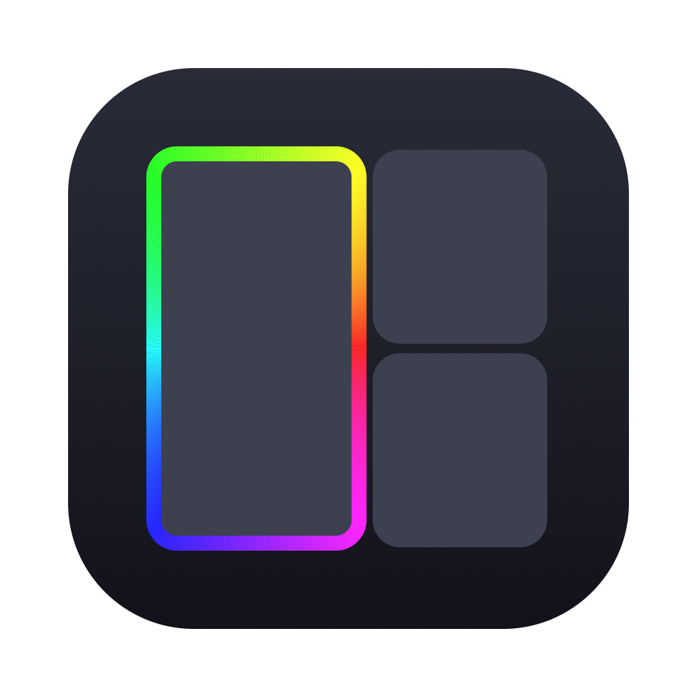

# Seam

An i3-style auto-tiling window manager for macOS. Native Swift, no dependencies.

**Very opinionated. Almost no config.** No config file, no settings window. Keys, gaps (none) and
the rainbow focus outline are hardcoded on purpose. The one thing you choose is which apps never tile (⌘⌥⇧C). If you want something
different, fork it and change the code.

## What it does

- New windows split the biggest tile, two columns at most: side by side, then ½ over ½ on the right, then a 2×2 grid. A fifth opens the next workspace, and a workspace is gone once its last window closes.
- Only what yabai would tile gets tiled. Always-on-top windows like Firefox's picture-in-picture, and windows on every desktop, are left alone.
- Tiles sit edge to edge with no gaps, and the focused one gets a spinning rainbow outline.
- Drag a tile's edge to resize it, and its neighbours follow.
- Drag a window to an empty display, or ⌘⌥ arrow it there, and it tiles there.
- Drag a window onto another one. Dropping it on an edge splits there, and dropping it in the middle swaps them.
- Dialogs always float. So do System Settings and Calculator, and any app you turn tiling off for (⌘⌥⇧C, remembered).
- Each display has its own layout, and the layout survives restarting Seam.

## Shortcuts

Every shortcut is ⌘⌥ + key. They're system-wide, so they override app shortcuts that use the same keys.

| Keys | Action |
|---|---|
| ⌘⌥ ←→↑↓ | Swap places with the window in that direction (a narrowed lone window moves left / centre / right) |
| ⌘⌥⇧ ←→↑↓ | Focus the window in that direction |
| ⌘⌥ ↩ | Whole screen (toggle) |
| ⌘⌥ C | Float / tile this window |
| ⌘⌥⇧ C | Never tile this app / tile it again (remembered) |
| ⌘⌥ T | Flip the focused window's group: side by side ⇄ stacked |
| ⌘⌥ S | Stack the next window under this one / unstack |
| ⌘⌥ - / = | Shrink / grow width by 10% (a window alone on its display shrinks toward the middle) |
| ⌘⌥ 0 | Even out all splits on the display |
| ⌘⌥ 1–9 | Switch workspace (the menu bar shows which) |
| ⌘⌥⇧ 1–9 | Send this window to a workspace |

The menu bar item lists them all, plus Retile Everything and Quit.

## Build

```sh
./build.sh          # → build/Seam.app (signed with your Apple Development cert if you have one)
open build/Seam.app
```

Seam needs the Accessibility permission. macOS asks for it the first time you open Seam. If tiling stops
working after a rebuild, go to System Settings › Privacy & Security › Accessibility, remove Seam
and add it again.

Requires macOS 14+.
