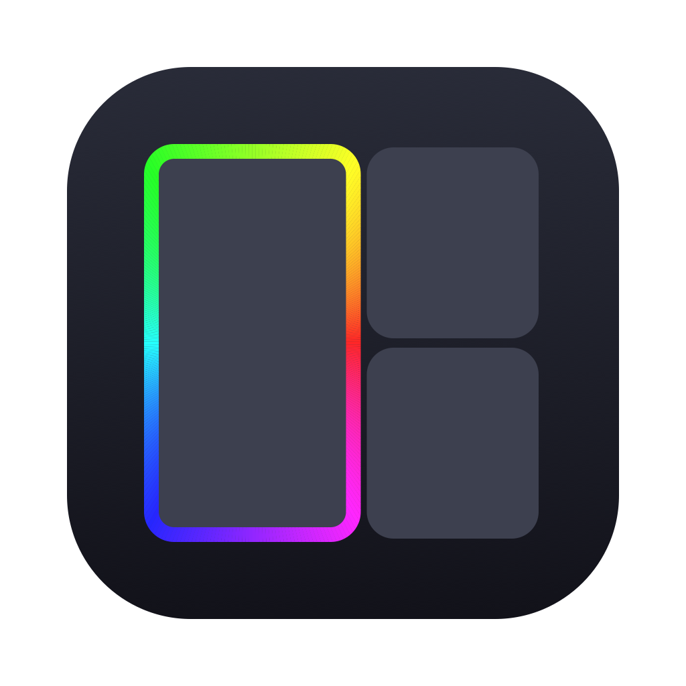

# Seam

An i3-style auto-tiling window manager for macOS. Native Swift, no dependencies.

**Very opinionated. No config.** No config file, no settings window, no preferences. Keys, gaps
(none), float rules and the rainbow focus outline are hardcoded on purpose. If you want something
different, fork it and change the code.

## What it does

- New windows split the focused one along its longer side.
- Tiles sit edge to edge with no gaps, and the focused one gets a spinning rainbow outline.
- Drag a tile's edge to resize it, and its neighbours follow.
- Drag a window onto another one. Dropping it on an edge splits there, and dropping it in the middle swaps them.
- Dialogs, System Settings and Calculator always float.
- Each display has its own layout, and the layout survives restarting Seam.

## Shortcuts

Every shortcut is ⌘⌥ + key. They're system-wide, so they override app shortcuts that use the same keys.

| Keys | Action |
|---|---|
| ⌘⌥ ←→↑↓ | Swap places with the window in that direction |
| ⌘⌥⇧ ←→↑↓ | Focus the window in that direction |
| ⌘⌥ ↩ | Whole screen (toggle) |
| ⌘⌥ C | Float / tile |
| ⌘⌥ T | Flip the focused window's group: side by side ⇄ stacked |
| ⌘⌥ S | Stack the next window under this one / unstack |
| ⌘⌥ - / = | Shrink / grow width by 10% |
| ⌘⌥ 0 | Even out all splits on the display |

The menu bar item lists them all, plus Retile Everything and Quit.

## Build

```sh
./build.sh          # → build/Seam.app (signed with your Apple Development cert if you have one)
open build/Seam.app
```

Seam needs the Accessibility permission. macOS asks for it the first time you open Seam. If tiling stops
working after a rebuild, go to System Settings › Privacy & Security › Accessibility, remove Seam
and add it again.

Requires macOS 14+.
